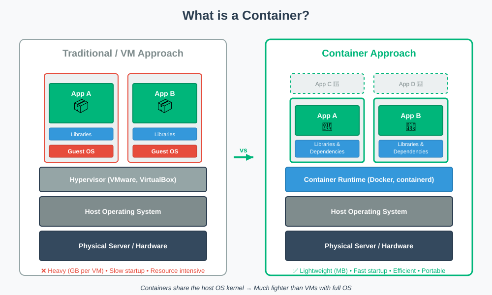
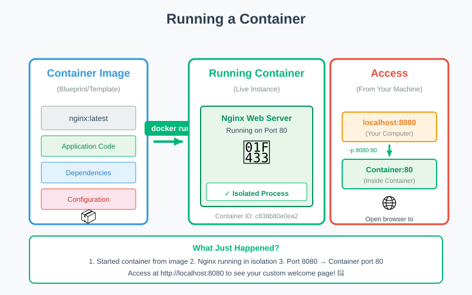
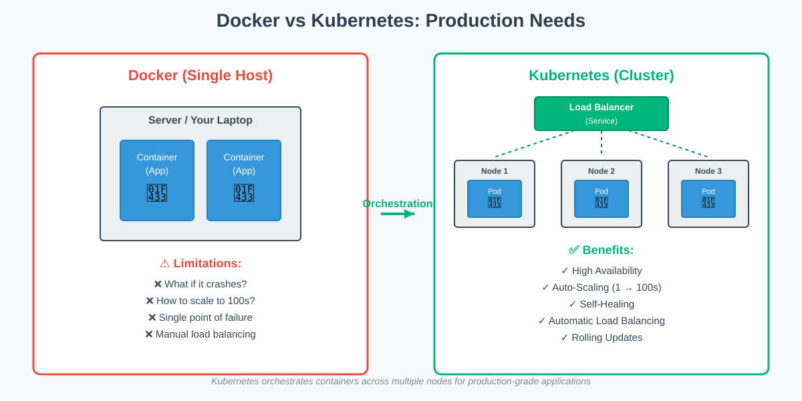
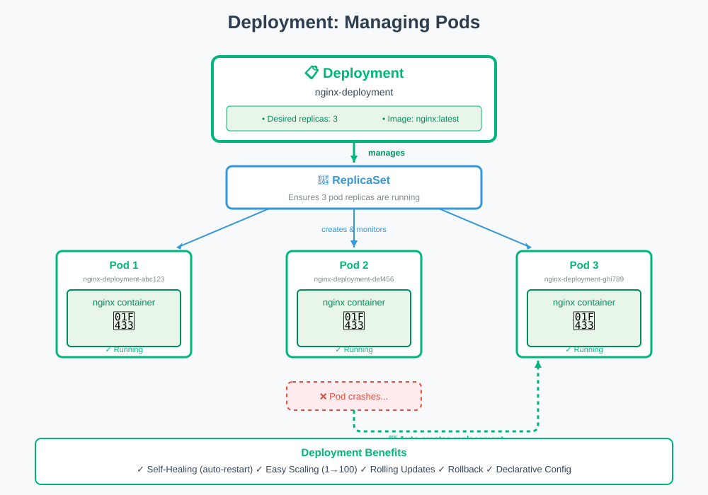
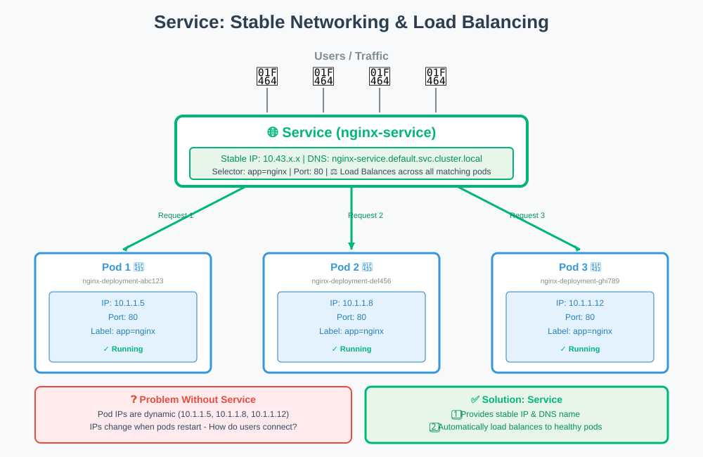

# Kubernetes 101

Kubernetes 101 is a beginner-friendly tutorial designed for those with no prior knowledge or experience with Kubernetes. This tutorial can be used as standalone learning material or as part of a 1-hour interactive workshop.

## Quick Navigation

- 📚 **Self-learners**: Continue reading below - this README is your complete guide
- 🎓 **Workshop participants**: Follow this README during the session
- 📖 **Quick reference**: Check out [Kubernetes-101-Quick-Reference.md](Kubernetes-101-Quick-Reference.md) for a printable cheat sheet

## Goal

Establish a foundational understanding of Kubernetes, combining theoretical knowledge with hands-on experience. By the end of this tutorial, you will understand:
- What containers are and how they work
- The relationship between Docker containers and Kubernetes
- Core Kubernetes concepts: Pods, Deployments, and Services

## Prerequisites

- Basic familiarity with command-line/terminal usage
- A Mac with Apple Silicon or a Linux machine
- No prior Docker or Kubernetes experience required!

## Project Structure

```
kubernetes101/
├── app/                    # Flask application
│   ├── app.py             # Main application code
│   ├── requirements.txt   # Python dependencies
│   └── Dockerfile         # Container build instructions
│
├── k8s/                    # Kubernetes manifests
│   ├── pod.yaml           # Basic Pod definition
│   ├── deployment.yaml    # Scalable Deployment
│   └── service.yaml       # ClusterIP Service
│
├── img/                    # Tutorial diagrams (SVG)
│
└── README.md              # This tutorial (you are here!)
```

**Quick tip:** The `app/` directory contains your Flask application, and `k8s/` contains all Kubernetes configuration files.

## Installation & Setup (15 minutes)

We'll use **Colima** as our container runtime and Kubernetes platform. Colima is lightweight, free, and works great on Apple Silicon Macs and Linux.

### For macOS (Apple Silicon)

1. **Install Homebrew** (if not already installed):
   ```sh
   /bin/bash -c "$(curl -fsSL https://raw.githubusercontent.com/Homebrew/install/HEAD/install.sh)"
   ```

2. **Install Colima, Docker CLI, and kubectl**:
   ```sh
   brew install colima docker kubectl
   ```

3. **Start Colima with Kubernetes enabled**:
   ```sh
   colima start --kubernetes --cpu 2 --memory 4
   ```

### For Linux

1. **Install Docker CLI**:
   ```sh
   # Ubuntu/Debian
   sudo apt-get update
   sudo apt-get install docker.io

   # Fedora
   sudo dnf install docker
   ```

2. **Install Colima**:
   ```sh
   # Using Homebrew on Linux
   brew install colima

   # Or download from releases
   # https://github.com/abiosoft/colima/releases
   ```

3. **Install kubectl**:
   ```sh
   # Ubuntu/Debian
   sudo apt-get install kubectl

   # Fedora
   sudo dnf install kubernetes-client
   ```

4. **Start Colima with Kubernetes**:
   ```sh
   colima start --kubernetes --cpu 2 --memory 4
   ```

### For both platforms

**Verify your setup**:
```sh
# Check Docker is working
docker version

# Check Kubernetes is running
kubectl version --short
kubectl get nodes
```

Expected output for `kubectl get nodes`:
```
NAME                   STATUS   ROLES           AGE   VERSION
colima                 Ready    control-plane   1m    v1.28.x
```

**Editor**: Have a text editor ready (Visual Studio Code, Vim, nano, or your preference)

---

## Tutorial Structure (1 hour total)

1. **Setup verification** (5 min)
2. **Understanding Containers** (15 min)
3. **From Docker to Kubernetes** (10 min)
4. **Kubernetes Pods** (10 min)
5. **Kubernetes Deployments** (10 min)
6. **Kubernetes Services** (10 min)

---

## Part 1: Understanding Containers (15 minutes)

### Theory: What is a Container?

A **container** is a standardized unit of software that packages an application and all its dependencies together. Think of it as a lightweight, portable box that contains everything needed to run a piece of software.

**Key concepts:**
- **Isolation**: Containers isolate applications from each other and from the host system
- **Portability**: "Build once, run anywhere" - containers work the same on your laptop, a server, or the cloud
- **Efficiency**: Containers share the host OS kernel, making them much lighter than virtual machines
- **Consistency**: No more "it works on my machine" problems

**Container vs Virtual Machine:**
- VMs include a full OS (gigabytes), containers share the host OS (megabytes)
- VMs take minutes to start, containers start in seconds
- You can run many more containers than VMs on the same hardware



### Practice: Running Your First Container

Let's build and run a **Python Flask web application** in a container!

1. **Build the Flask app image**:
   ```sh
   cd app
   docker build -t hello-python:latest .
   cd ..
   ```

   This builds our Flask application into a container image. You'll see Docker:
   - Pulling the Python 3.11 base image
   - Installing Flask and dependencies
   - Copying the application code
   - Creating the final image

2. **Run the Flask app container**:
   ```sh
   # Remove any existing container with the same name (if re-running)
   docker rm -f web-server 2>/dev/null || true

   # Run the Flask application
   docker run --name web-server -d -p 8080:8080 hello-python:latest
   ```

   Let's break down this command:
   - `docker run`: Start a new container
   - `--name web-server`: Give it a friendly name
   - `-d`: Run in detached mode (background)
   - `-p 8080:8080`: Map port 8080 on your laptop to port 8080 in the container
   - `hello-python:latest`: The image we just built

   Expected output: a long container ID (e.g., `c838b80e0ea2...`)

3. **Check if the container is running**:
   ```sh
   docker ps
   ```
   You should see your web-server container listed.

4. **Access the Flask app**:
   ```sh
   curl localhost:8080
   ```
   Or open a browser and go to `http://localhost:8080`

   You'll see "🐍 Hello World!" with:
   - Container hostname
   - Pod IP address
   - Python version
   - Beautiful purple gradient design! 🐍

   **What just happened?**
   - You built a Docker image from a Dockerfile
   - The container is running a Flask web application
   - Port mapping lets you access the app from your host machine
   - All dependencies (Flask, Python) are bundled in the container

   

5. **Explore the container**:
   ```sh
   # View container logs (shows Flask access logs)
   docker logs web-server

   # Follow logs in real-time
   docker logs -f web-server

   # Execute a command inside the container
   docker exec -it web-server /bin/bash
   # You're now inside the container! Type 'exit' to leave

   # Check the health endpoint
   curl localhost:8080/health
   ```

6. **Stop and remove the container**:
   ```sh
   docker stop web-server
   docker rm web-server
   ```

   **Tip**: If you get a "name already in use" error, use:
   ```sh
   docker rm -f web-server  # Force remove (stops and removes)
   ```

**Key Takeaway**: Containers let you package applications with all their dependencies. You built a real Flask app, containerized it, and ran it - without installing Flask or Python on your system!

**Pro Tip**: Use `--rm` flag to auto-remove containers when stopped:
```sh
docker run --rm --name web-server -d -p 8080:8080 hello-python:latest
```

---

## Part 2: From Docker to Kubernetes (10 minutes)

### Theory: Why Kubernetes?

Docker is great for running containers on a single machine, but production applications need:
- **High availability**: What if a container crashes?
- **Scalability**: What if you need 100 copies to handle traffic?
- **Load balancing**: How do you distribute traffic across containers?
- **Rolling updates**: How do you update without downtime?
- **Self-healing**: Automatic restart of failed containers

**This is where Kubernetes comes in.**



**Kubernetes** is a container orchestration platform that automates:
- Deployment and scaling of containers
- Load balancing and service discovery
- Self-healing (restarting failed containers)
- Rolling updates and rollbacks
- Resource management

**The relationship:**
- **Docker** (or other container runtimes): Builds and runs individual containers
- **Kubernetes**: Orchestrates and manages many containers across multiple machines

Think of it like this:
- Docker is like driving a single car
- Kubernetes is like managing a fleet of taxis - automatically dispatching, replacing broken ones, scaling up during rush hour

```

### Practice: Verify Kubernetes is Running

Let's confirm Kubernetes is ready:

```sh
# Check cluster status
kubectl cluster-info

# See the nodes (machines) in your cluster
kubectl get nodes

# See all running system pods
kubectl get pods -A
```

You should see various system pods running - these are Kubernetes' own components!

---

## Part 3: Pods - The Basic Unit (10 minutes)

### Theory: What is a Pod?

A **Pod** is the smallest and simplest unit in Kubernetes. It's a wrapper around one or more containers.

**Key concepts:**
- A Pod represents a single instance of a running process in your cluster
- Pods usually contain one container (but can have multiple that need to work together)
- Containers in a Pod share:
  - Network namespace (same IP address and port space)
  - Storage volumes
  - Lifecycle (they start and stop together)

**Why not just run containers directly?** Kubernetes adds:
- Declarative configuration (you describe what you want, K8s makes it happen)
- Automatic scheduling (K8s decides where to run it)
- Health monitoring and restart
- Resource allocation

### Practice: Create Your First Pod

1. **Make sure you've built the Flask app image** (from Part 1):
   ```sh
   # If you haven't built it yet
   cd app
   docker build -t hello-python:latest .
   cd ..
   ```

2. **Create a Pod definition file** `k8s/pod.yaml` (already provided):
   ```yaml
   apiVersion: v1
   kind: Pod
   metadata:
     name: hello-pod
   spec:
     containers:
       - name: python-app
         image: hello-python:latest
         imagePullPolicy: Never  # Use local image
         ports:
         - containerPort: 8080
         env:
         - name: APP_VERSION
           value: "1.0.0"
   ```

   Let's understand this YAML:
   - `apiVersion`: Which version of the Kubernetes API we're using
   - `kind`: What type of resource (Pod, Deployment, Service, etc.)
   - `metadata`: Information about the Pod (name, labels, etc.)
   - `spec`: The desired state - what containers to run
   - `image`: Our Flask app image
   - `imagePullPolicy: Never`: Use the local image we built

3. **Apply the configuration** (tell Kubernetes to create the Pod):
   ```sh
   kubectl apply -f k8s/pod.yaml
   ```

4. **Watch it being created**:
   ```sh
   kubectl get pods
   # or watch in real-time
   kubectl get pods --watch
   ```

   You should see:
   ```
   NAME        READY   STATUS    RESTARTS   AGE
   hello-pod   1/1     Running   0          10s
   ```

5. **Inspect the Pod details**:
   ```sh
   kubectl describe pod hello-pod
   ```
   This shows events, IP address, which node it's on, and more!

6. **Access the Flask app in the Pod**:
   ```sh
   kubectl port-forward pod/hello-pod 8080:8080
   ```
   Keep this running and in another terminal (or browser) visit `http://localhost:8080`

   You'll see the Flask "Hello World" page with the pod's hostname!

7. **View Pod logs**:
   ```sh
   kubectl logs hello-pod
   ```
   You'll see Flask access logs.

8. **Execute commands in the Pod**:
   ```sh
   kubectl exec -it hello-pod -- /bin/bash
   # You're now inside the Pod! Type 'exit' to leave

   # Or check the health endpoint
   kubectl exec hello-pod -- curl localhost:8080/health
   ```

9. **Clean up**:
   ```sh
   kubectl delete pod hello-pod
   ```

**Key Takeaway**: Pods run your containerized applications in Kubernetes. The same Flask app that ran in Docker now runs in a Kubernetes Pod!

---

## Part 4: Deployments - Managing Scale (10 minutes)

### Theory: What is a Deployment?

Running a single Pod is great for learning, but in production you need:
- **Multiple replicas** for high availability (if one crashes, others handle traffic)
- **Easy scaling** up and down based on load
- **Rolling updates** without downtime
- **Rollback** if something goes wrong

A **Deployment** provides all of this. It's a higher-level concept that manages Pods for you.

**Key concepts:**
- Deployments create and manage **ReplicaSets**
- ReplicaSets ensure the desired number of Pod replicas are running
- If a Pod crashes, the Deployment automatically creates a new one
- You declare desired state, Kubernetes makes it happen



**Why use Deployments instead of Pods directly?**
- Self-healing: Automatically replaces failed Pods
- Declarative scaling: Just change the replica count
- Rolling updates: Update without downtime
- Easy rollback: Undo problematic updates

### Practice: Create and Scale a Deployment

1. **Create a Deployment** using `k8s/deployment.yaml`:
   ```yaml
   apiVersion: apps/v1
   kind: Deployment
   metadata:
     name: hello-deployment
   spec:
     replicas: 1
     selector:
       matchLabels:
         app: hello
     template:
       metadata:
         labels:
           app: hello
       spec:
         containers:
         - name: python-app
           image: hello-python:latest
           imagePullPolicy: Never
           ports:
           - containerPort: 8080
           env:
           - name: APP_VERSION
             value: "1.0.0"
   ```

   Notice the structure:
   - `replicas`: How many Pod copies to run
   - `selector`: How to find Pods managed by this Deployment (by labels)
   - `template`: The Pod template (same as our Pod YAML earlier!)
   - Uses the same `hello-python` Flask app image

2. **Apply the Deployment**:
   ```sh
   kubectl apply -f k8s/deployment.yaml
   ```

3. **Watch it create Pods**:
   ```sh
   kubectl get deployments
   kubectl get pods
   ```

   You should see:
   ```
   NAME               READY   UP-TO-DATE   AVAILABLE   AGE
   hello-deployment   1/1     1            1           10s
   ```

4. **Access the deployment** to see it working:
   ```sh
   kubectl port-forward deployment/hello-deployment 8080:8080
   ```
   Visit `http://localhost:8080` - notice the **Hostname** field shows the pod name!

5. **Scale to 3 replicas**:
   ```sh
   kubectl scale deployment hello-deployment --replicas=3
   kubectl get pods
   ```

   Watch as Kubernetes creates 2 more Pods! You now have 3 identical Flask apps running.

6. **View the running Pods**:
   ```sh
   kubectl port-forward deployment/hello-deployment 8080:8080
   ```

   Visit `http://localhost:8080` - you can see the app running. Note that port-forwarding to a Deployment connects to a single Pod. To see load balancing across multiple Pods, you'll need a Service (covered in Part 5).

7. **Test self-healing** - delete a Pod and watch it automatically recreate:
   ```sh
   # Get a Pod name
   kubectl get pods

   # Delete one Pod
   kubectl delete pod <POD_NAME>

   # Immediately check again - a new one is already being created!
   kubectl get pods
   ```

   Kubernetes detected that you only have 2/3 Pods and immediately created a replacement. This is **self-healing**.

8. **Scale down**:
   ```sh
   kubectl scale deployment hello-deployment --replicas=2
   kubectl get pods
   ```

9. **View Deployment history and details**:
   ```sh
   kubectl describe deployment hello-deployment
   kubectl rollout status deployment hello-deployment
   kubectl rollout history deployment hello-deployment
   ```

**Key Takeaway**: Deployments manage the lifecycle of your Pods, providing scaling, self-healing, and update management. The Flask app shows you which pod is responding through the hostname - perfect for seeing load balancing in action!

---

## Part 5: Services - Stable Networking (10 minutes)

### Theory: What is a Service?

You now have multiple Flask Pods running, but there's a problem:
- Each Pod has its own IP address
- Pod IPs are **dynamic** - they change when Pods restart or are recreated
- How do you access your application reliably?
- How do you load balance across all replicas?

A **Service** solves this by providing a **stable endpoint** for accessing Pods.

**Key concepts:**
- Services provide a single, stable IP and DNS name
- They automatically load balance traffic across matching Pods
- Services use **selectors** to find Pods (matching labels)
- We'll use `LoadBalancer` type which works great with Colima (exposes the app externally)



**Think of it like a restaurant:**
- Pods are the chefs (they come and go)
- Service is the reception desk (always there, directs customers to available chefs)

### Practice: Expose Your Deployment

1. **Examine the Service configuration** in `k8s/service.yaml`:
   ```yaml
   apiVersion: v1
   kind: Service
   metadata:
     name: hello-service
   spec:
     type: LoadBalancer
     selector:
       app: hello
     ports:
       - protocol: TCP
         port: 80
         targetPort: 8080
   ```

   Key fields:
   - `type: LoadBalancer`: Makes the Service accessible from outside the cluster
   - `selector: app: hello`: Finds all Pods with this label
   - `port: 80`: External port (what you connect to)
   - `targetPort: 8080`: Container port (where Flask app listens)

2. **Apply the Service**:
   ```sh
   kubectl apply -f k8s/service.yaml
   ```

3. **Check the Service**:
   ```sh
   kubectl get services hello-service
   ```

   You should see:
   ```
   NAME            TYPE           CLUSTER-IP      EXTERNAL-IP   PORT(S)        AGE
   hello-service   LoadBalancer   10.43.x.x       localhost     80:xxxxx/TCP   10s
   ```

   For Colima, `EXTERNAL-IP` shows `localhost`, meaning you can access it at `http://localhost`!

4. **See load balancing in action**:

   Make several requests to see different Pods responding:
   ```sh
   for i in {1..10}; do
     response=$(curl -s http://localhost)
     pod_ip=$(echo "$response" | grep -oE '[0-9]+\.[0-9]+\.[0-9]+\.[0-9]+' | head -1)
     echo "Response from Pod IP: $pod_ip"
   done
   ```

   You'll see requests distributed across different Pod IPs! This is the Service load balancing your traffic across all replicas.

   Example output:
   ```
   Response from Pod IP: 10.42.0.5
   Response from Pod IP: 10.42.0.7
   Response from Pod IP: 10.42.0.5
   Response from Pod IP: 10.42.0.6
   ```

5. **View the Service in your browser**:
   Visit `http://localhost` and refresh the page multiple times. Watch the **Hostname** and **Pod IP** change - that's load balancing in action!

6. **Inspect the Service**:
   ```sh
   kubectl describe service hello-service
   ```

   Notice the `Endpoints` section - it lists all the Pod IPs that match the selector. This is how the Service knows where to send traffic.

**Key Takeaway**: Services provide stable networking and load balancing. They're the bridge between the dynamic world of Pods and the stable endpoints your applications need. With LoadBalancer type, your application is accessible from outside the cluster and automatically load balanced!

---

## Bonus: Exploring and Extending the Flask App (Optional)

Want to go deeper? Let's explore the Flask application and learn how to extend it!

### Understanding the Application

You've been using the Flask app throughout the tutorial. Let's look at what makes it work:

1. **Examine `app/app.py`**:
   ```python
   # Key features:
   - Flask web framework
   - HTML template with dynamic data (hostname, IP)
   - Health check endpoint at /health
   - Environment variable support
   - Shows which pod is responding
   ```

2. **Examine `app/Dockerfile`**:
   ```dockerfile
   FROM python:3.11-slim        # Base image (~150MB)
   WORKDIR /app                 # Set working directory
   COPY requirements.txt .      # Copy dependencies
   RUN pip install ...          # Install Flask
   COPY app.py .               # Copy app code
   ENV PORT=8080               # Set environment
   CMD ["python", "app.py"]    # Run the app
   ```

3. **Dependencies in `app/requirements.txt`**:
   ```
   Flask==3.0.0    # Web framework
   Werkzeug==3.0.1 # WSGI utilities
   ```

### Extending the Application

Try these exercises to learn more:

**1. Add a New Route**

Edit `app/app.py` and add a new endpoint:
```python
@app.route('/api/info')
def info():
    return {
        'app': 'hello-world',
        'version': os.environ.get('APP_VERSION', '1.0.0'),
        'hostname': socket.gethostname(),
        'python': f"{sys.version_info.major}.{sys.version_info.minor}"
    }, 200
```

Rebuild and test:
```sh
cd app
docker build -t hello-python:latest .
docker run --rm -p 8080:8080 hello-python:latest
curl localhost:8080/api/info
```

**2. Change the App Version**

Update the environment variable in `k8s/deployment.yaml`:
```yaml
env:
- name: APP_VERSION
  value: "2.0.0"  # Change this!
```

Apply and check:
```sh
kubectl apply -f k8s/deployment.yaml
kubectl port-forward deployment/hello-deployment 8080:8080
# Visit the page - you'll see version 2.0.0!
```

**3. Add Request Counter**

Make the app count requests (add to `app.py`):
```python
request_count = 0

@app.route('/')
def hello():
    global request_count
    request_count += 1
    # Pass request_count to template
    return render_template_string(HTML_TEMPLATE,
        hostname=hostname,
        request_count=request_count,
        ...)
```

**4. Deploy with More Replicas**

Scale up to see load balancing:
```sh
kubectl scale deployment hello-deployment --replicas=5
kubectl get pods
kubectl port-forward deployment/hello-deployment 8080:8080
```

Refresh the page repeatedly - you'll see 5 different hostnames rotating!

### Production Considerations

To make this production-ready, you'd add:
- **Persistent storage** for data
- **Database connection** (PostgreSQL, MongoDB)
- **Logging** to files or external systems
- **Metrics** for monitoring (Prometheus)
- **HTTPS** with TLS certificates
- **ConfigMaps** for configuration
- **Secrets** for sensitive data
- **Ingress** for HTTP routing
- **Resource limits** (CPU, memory)

### Key Takeaways

- You built a real Flask application from scratch
- Containerized it with Docker
- Deployed it to Kubernetes with multiple replicas
- Saw load balancing in action through the hostname
- Learned how to extend and modify the app

The same principles apply to any application - Python, Node.js, Go, Java, etc. You now have the foundation to containerize and orchestrate any web application!

---

## Cleanup

When you're done with the tutorial, clean up your resources:

```sh
# Delete all resources we created
kubectl delete deployment hello-deployment
kubectl delete service hello-service hello-lb
kubectl delete pod hello-pod  # if it still exists

# Verify everything is cleaned up
kubectl get all

# Remove local Docker images (optional)
docker rmi hello-python:latest

# Stop Colima (optional)
colima stop
```

---

## Summary: What You've Learned

Congratulations! In this tutorial, you've learned:

1. **Containers**: Lightweight, portable units that package applications and dependencies
   - Isolation, portability, and efficiency
   - Running Python applications in containers

2. **Kubernetes**: Container orchestration platform
   - Automates deployment, scaling, and management
   - Builds on top of container runtimes like Docker

3. **Pods**: The basic unit in Kubernetes
   - Wrap one or more containers
   - Share networking and storage
   - Declarative configuration with YAML

4. **Deployments**: Manage the lifecycle of Pods
   - Self-healing and automatic restarts
   - Easy scaling up and down
   - Rolling updates and rollbacks

5. **Services**: Stable networking for Pods
   - Provide constant endpoints despite Pod changes
   - Load balancing across replicas
   - Map external ports to container ports

6. **Building Applications**: Creating custom container images
   - Write Dockerfiles to package your apps
   - Install dependencies (Python, Flask, etc.)
   - Deploy custom apps to Kubernetes

### The Big Picture

```
Container (Docker) → Pod → Deployment → Service
     ↓                ↓         ↓            ↓
   Runtime        Basic Unit  Lifecycle   Networking
```

---

## Next Steps

Ready to learn more? Here are some next topics:

1. **ConfigMaps and Secrets**: Managing configuration and sensitive data
2. **Namespaces**: Organizing resources in your cluster
3. **Ingress**: HTTP/HTTPS routing and load balancing
4. **Persistent Volumes**: Storing data that survives Pod restarts
5. **Health Checks**: Liveness and readiness probes
6. **Resource Limits**: CPU and memory management
7. **Helm**: Package manager for Kubernetes

### Useful Commands Reference

```sh
# Cluster info
kubectl cluster-info
kubectl get nodes

# Working with resources
kubectl get pods
kubectl get deployments
kubectl get services
kubectl get all

# Detailed info
kubectl describe pod <POD_NAME>
kubectl describe deployment <DEPLOYMENT_NAME>

# Logs and debugging
kubectl logs <POD_NAME>
kubectl logs -f <POD_NAME>  # follow
kubectl exec -it <POD_NAME> -- /bin/bash

# Apply configurations
kubectl apply -f <FILE>
kubectl delete -f <FILE>

# Scaling
kubectl scale deployment <NAME> --replicas=<N>

# Port forwarding
kubectl port-forward pod/<POD_NAME> 8080:80
kubectl port-forward service/<SERVICE_NAME> 8080:80
```

---

## Troubleshooting

**"Container name already in use" error:**
```sh
# Remove the existing container
docker rm -f web-server

# Or use --rm flag to auto-cleanup
docker run --rm --name web-server -d -p 8080:8080 hello-python:latest
```

**Colima won't start:**
```sh
# Check if another Docker runtime is running
docker context ls
# Switch to colima if needed
docker context use colima
```

**Pods stuck in "Pending" state:**
```sh
kubectl describe pod <POD_NAME>
# Look for events at the bottom
```

**Can't access Service:**
```sh
# Check if Pods are running
kubectl get pods

# Check Service endpoints
kubectl describe service <SERVICE_NAME>

# Use port-forward as alternative
kubectl port-forward service/<SERVICE_NAME> 8080:80
```

---

## Resources

### Tutorial Materials
- **[Quick Reference Guide](Kubernetes-101-Quick-Reference.md)** - Printable cheat sheet with all essential commands
- **Tutorial Repository** - You're here! Clone and share

### External Resources
- [Kubernetes Official Documentation](https://kubernetes.io/docs/)
- [Colima GitHub](https://github.com/abiosoft/colima)
- [Docker Documentation](https://docs.docker.com/)
- [Flask Documentation](https://flask.palletsprojects.com/)
- [kubectl Cheat Sheet](https://kubernetes.io/docs/reference/kubectl/cheatsheet/)

### Books and Guides
- [Kubernetes Patterns Book](https://www.redhat.com/en/resources/oreilly-kubernetes-patterns-cloud-native-apps)
- [Kubernetes Up & Running](https://www.oreilly.com/library/view/kubernetes-up-and/9781492046523/)

---

## Contribute

Contributions are welcome! Feel free to:
- Open GitHub issues for bugs or suggestions
- Submit pull requests with improvements
- Share feedback on what worked well or could be better

## Author

Created with 💚 by [Daniel Fratte](https://www.linkedin.com/in/drfratte/)

---

**Happy learning! 🚀 May your containers always run and your pods always be ready!**