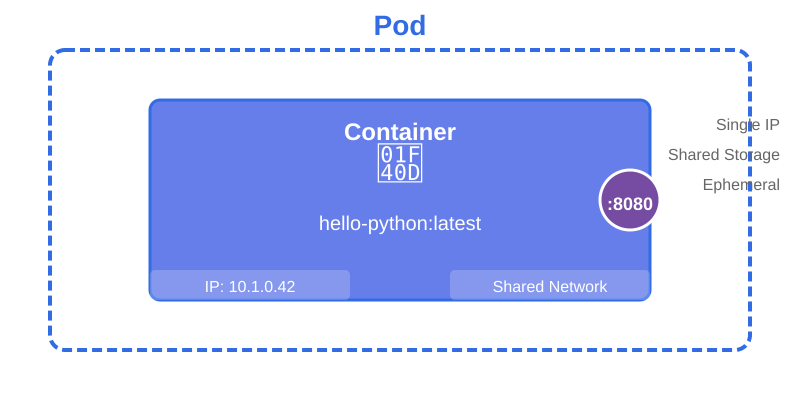

# Kubernetes 101 Workshop

---

## Kubernetes 101: From Containers to Orchestration
### A Hands-On Workshop

Daniel Fratte | 27/02/2026

---

## Today's Journey (Agenda)
What We'll Cover Today (60 minutes)

- 🐳 **Part 1:** What are Containers? (10 min)
- 🔄 **Part 2:** Docker → Kubernetes (5 min)
- ☸️ **Part 3:** Kubernetes Basics - Pods (10 min)
- 📦 **Part 4:** Deployments & Scaling (15 min)
- 🌐 **Part 5:** Services & Load Balancing (15 min)
- 🎯 **Part 6:** Wrap-up & Resources (5 min)

<!-- **Speaker Notes:**
This is a hands-on workshop. We'll switch between theory (slides) and practice (your laptops) throughout. Don't worry if you fall behind - the full tutorial is available for you to follow at your own pace later. -->

---

## Prerequisites Check
Before We Start - Quick Check ✅


Do you have these installed?
- ✅ Colima (or Docker Desktop)
- ✅ kubectl
- ✅ Terminal/command line access

**Not installed yet?**
👉 Pair up with someone who has it, or follow along for now and try later

<!-- **Speaker Notes:**
Quick show of hands - who has Colima running? Who has kubectl? Don't worry if you don't - you can still learn conceptually and try the hands-on later. -->

---

## The Problem We're Solving
Why Do Containers & Kubernetes Exist?

**The Classic Developer Problem:**
- 😫 "It works on my machine!"
- 🔧 Different OS, dependencies, versions
- 📦 Complex setup for new team members
- 🌍 Development ≠ Production environment

**The Solution:**
- 🐳 Containers: Package everything together
- ☸️ Kubernetes: Run containers reliably at scale

---


<!-- **Speaker Notes:**
Think of VMs as separate houses - each with their own foundation, walls, plumbing. Containers are like apartments - they share infrastructure but are still separate and secure. -->

---

## Container Benefits
Why Containers Won


✅ **Portability:** Run anywhere (laptop, server, cloud)
✅ **Consistency:** Same environment everywhere
✅ **Speed:** Start in seconds, not minutes
✅ **Efficiency:** Run 10s-100s on one machine
✅ **Isolation:** Apps don't interfere with each other

**Real-world example:**
Netflix runs 1000s of containers to serve millions of users

---

## Docker - The Container Runtime

**Docker lets you:**
1. **Build** container images (like a recipe)
2. **Run** containers from images (like baking from recipe)
3. **Share** images (via registries like Docker Hub)

**Key Concept:**
```
Image (template) → Container (running instance)
```

Like: Class → Object, or Recipe → Cake

<!-- **Speaker Notes:**
Docker democratized containers. Before Docker, containers were complex. Docker made them accessible to developers everywhere. -->

---

## When Docker Isn't Enough


<!--
❌ What if a container crashes?
❌ What if the server fails?
❌ How do you scale to 100 containers?
❌ How do you load balance traffic?
❌ How do you manage updates?

**Enter Kubernetes 👑** -->

---

## What is Kubernetes?
Kubernetes: The Container Orchestrator

**Kubernetes is like an autopilot for containers**

🎯 **Automatically:**
- Starts and stops containers
- Replaces failed containers (self-healing)
- Scales up/down based on demand
- Distributes traffic across containers
- Manages updates with zero downtime

**Origin:** Built by Google, now open-source (CNCF)

<!-- **Speaker Notes:**
Google runs billions of containers per week. Kubernetes (K8s) is based on their internal system "Borg". They open-sourced it in 2014 and it's now the industry standard. -->

---


---

## Kubernetes Core Concepts
The Building Blocks of K8s

**3 Key Resources:**

🔹 **Pod:** Smallest unit - one or more containers
🔹 **Deployment:** Manages multiple Pods (replicas + updates)
🔹 **Service:** Exposes Pods to network traffic (load balancer)

**Think of it as:**
- Pod = Single worker
- Deployment = Team manager
- Service = Reception desk

---

## Pods - Where Containers Live



---

**What is a Pod?**
- Wraps one (or more) containers
- Shared network and storage
- Has an IP address
- Ephemeral (disposable)

**Key Point:** You usually don't create Pods directly - Deployments do it for you!

---
### Pod definition
```yaml
apiVersion: v1
kind: Pod
metadata:
  name: hello-pod
spec:
  containers:
  - name: python-app
    image: hello-python:latest
    ports:
    - containerPort: 8080
```

---

## Deployments - Managing Pods at Scale


---

**What is a Deployment?**
- Creates and manages multiple Pods (replicas)
- Self-healing: recreates failed Pods
- Rolling updates: update without downtime
- Scaling: easily go from 1 → 100 Pods

**Key Feature:** Delete a Pod → Deployment immediately creates a new one

---
### Deployment definition
```yaml
apiVersion: apps/v1
kind: Deployment
metadata:
  name: hello-deployment
spec:
  replicas: 3
  selector:
    matchLabels:
      app: hello
  template:
    metadata:
      labels:
        app: hello
    spec:
      containers:
      - name: python-app
        image: hello-python:latest
        ports:
        - containerPort: 8080
```

<!-- This is where Kubernetes shines. If a Pod crashes, the Deployment controller notices and creates a replacement. You declare "I want 3 replicas" and Kubernetes makes it happen. -->

---

## Services - Stable Access to Your Pods


---

**The Problem:**
- Pods are ephemeral (die and restart)
- Pod IPs change constantly
- How do users reach your app?

**The Solution: Services**
- Stable IP address and DNS name
- Automatically load balances across Pods
- Finds Pods using labels

---

### Service definition
```yaml
apiVersion: v1
kind: Service
metadata:
  name: hello-service
spec:
  type: LoadBalancer
  selector:
    app: hello
  ports:
  - port: 80
    targetPort: 8080
```

**LoadBalancer type:**
- Exposes service externally
- Works great with Colima (uses localhost)
- Provides stable endpoint + load balancing

---

## How Services Find Pods

**Labels:** Key-value tags on resources
```yaml
labels:
  app: hello
  version: v1
```

**Selectors:** How Services find Pods
```yaml
selector:
  app: hello  # Match all Pods with this label
```

**Visual Analogy:**
- Labels = Name tags at conference
- Selectors = "Find all people from Engineering"

---

## Putting It All Together
The Full Picture: How K8s Works

```
User → Service → Pods ← Deployment
         ↓         ↓         ↓
    (Load Bal) (Workers) (Manager)
```

**Flow:**
1. User hits Service (stable endpoint)
2. Service routes to healthy Pod
3. If Pod fails, Deployment creates new one
4. Service automatically uses new Pod

**This is orchestration! 🎵**

---

## Demo Architecture
What We'll Build Today

**Our Flask Application:**
- 🐍 Python Flask web app
- Displays hostname, IP, version
- Shows which Pod is responding

**Why Flask?**
- Dynamic (not static HTML)
- Shows Pod identity
- Perfect for seeing load balancing in action!

**Architecture:** Docker build → K8s deploy → Browser access

---

## Hands-On Overview
What You'll Do (Step by Step)

**Part 1: Build**
- Build Docker image from Flask app

**Part 2: Pod**
- Run single Pod
- Access it via port-forward

---

**Part 3: Deployment**
- Create Deployment with 1 replica
- Scale to 3 replicas
- Test self-healing (delete a Pod)

**Part 4: Service**
- Create Service for load balancing
- See different Pod names on refresh

<!-- Now let's get our hands dirty! Open your terminals... -->

---

## Your Kubectl Cheat Sheet

```bash
# View resources
kubectl get pods
kubectl get deployments
kubectl get services

# Details
kubectl describe pod <name>

# Create/Delete
kubectl apply -f <file.yaml>
kubectl delete -f <file.yaml>

# Scaling
kubectl scale deployment <name> --replicas=3

# Access
kubectl port-forward pod/<name> 8080:8080
```

---

## Common Gotchas & Tips
Things to Remember 💡

**Common Issues:**
- ❌ Image not found → Check imagePullPolicy: Never
- ❌ Can't connect → Check port-forward is running
- ❌ Pods not starting → kubectl describe pod <name>

**Pro Tips:**
- ✅ Use `kubectl get pods -w` to watch in real-time
- ✅ Services need matching labels
- ✅ Port-forward runs in foreground - use new terminal

---

## Kubernetes in Production - Beyond the Basics

**What we didn't cover (but K8s can do):**
- 📊 ConfigMaps & Secrets (configuration)
- 💾 Persistent Volumes (storage)
- 🔐 RBAC (security/permissions)
- 📈 Horizontal Pod Autoscaling (auto-scale)
- 🔄 Ingress Controllers (HTTP routing)
- 📦 Namespaces (multi-tenancy)

<!-- Today was just the foundation. Kubernetes is incredibly powerful and has a rich ecosystem. But you now understand the core concepts! -->

---

## Key Takeaways
Remember These! 🎯

**Core Concepts:**
1. **Containers** = Lightweight, portable, consistent
2. **Docker** = Build and run containers (dev)
3. **Kubernetes** = Orchestrate containers (prod)
4. **Pod** = Wrapper for container(s)
5. **Deployment** = Manages Pods (scaling, healing)
6. **Service** = Stable access + load balancing

**The Magic:**
You declare what you want → Kubernetes makes it happen

---

## Q&A
Questions? Feedback? 🙋

**Thank you for participating! 🎉**